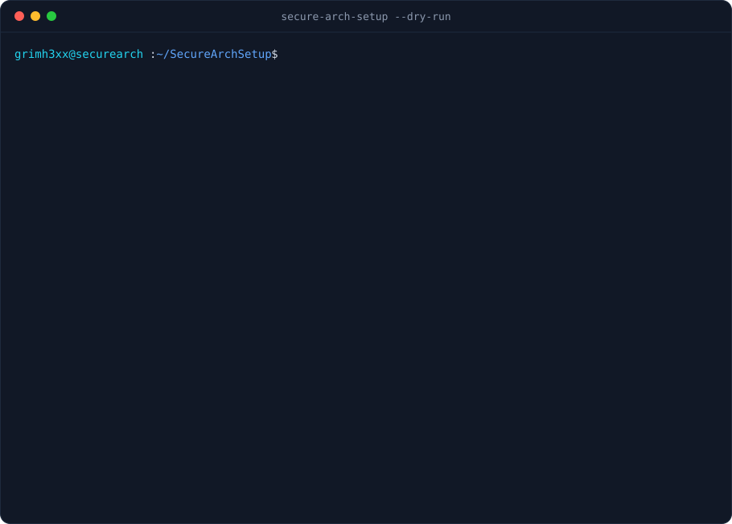

[](https://github.com/grimh3xx/SecureArchSetup/actions)
[](LICENSE)


**Hardening and pentest setup for Arch Linux, in plain Bash.** Runs right after
`pacstrap` with no extra dependencies. It previews every change before applying it, backs
up every file it touches, and can undo any run.

<p align="center"></p>

## Features

| | |
|---|---|
| **Kernel hardening** | 28 sysctl parameters: kernel pointer and dmesg restrictions, BPF and kexec lockdown, ptrace scope, protected links/FIFOs, anti-spoofing and redirect protection |
| **SSH** | Root login off, auth limits, no X11/agent forwarding. Password login is turned off **only if you already have an authorized key**, so it never locks you out. The config is validated with `sshd -t` and rolled back on error |
| **Firewall** | nftables with default-drop inbound, rate-limited SSH on your real port, and Docker-aware forwarding |
| **linux-hardened** | Installs the hardened kernel next to the stock one (fallback) and updates GRUB |
| **Docker** | Hardened `daemon.json` (no-new-privileges, no inter-container traffic, log rotation). Warns before adding you to the root-equivalent `docker` group |
| **Pentest toolsets** | recon · web · network · wireless · cracking · exploit. Uses the official repos first (or BlackArch if enabled), then paru/yay for the rest, run as your user, never as root |
| **Audit** | Read-only scan with a score and a Markdown report: kernel parameters, effective sshd config, firewall, sockets exposed beyond localhost, SUID/SGID files not owned by any package, world-writable paths, failed units, pending updates, known CVEs (`arch-audit`) |
| **Maintenance** | System + AUR update, `/etc` snapshot, AIDE integrity baseline |

**Safety built in**
- `--dry-run` shows a colored diff of every file and every command, without changing anything.
- Every modified file is copied to `/var/backups/secure-arch-setup/<run>/` first.
  `restore` undoes a whole run, including deleting files it created.
- It is idempotent: running it again only changes what drifted.
- Everything is logged to `/var/log/secure-arch-setup.log`.

## Quick start

```bash
sudo pacman -S --needed git
git clone https://github.com/grimh3xx/SecureArchSetup && cd SecureArchSetup

./secure-arch-setup --dry-run profile pentest   # preview, no root needed
sudo ./secure-arch-setup                        # interactive menu
```

To install it system-wide: `sudo make install` (adds `secure-arch-setup` to `/usr/local/bin`).

## Profiles

| Profile | Steps |
|---|---|
| `workstation` | sysctl · ssh · firewall · audit |
| `pentest` | workstation + recon, web, network and cracking toolsets |
| `full` | pentest + system update, linux-hardened, Docker, all toolsets, AIDE |

```bash
sudo secure-arch-setup profile workstation
sudo secure-arch-setup --yes profile full        # unattended
```

## Commands

```text
secure-arch-setup [options] [command]

  menu                      interactive menu (default)
  profile NAME              workstation | pentest | full
  harden [STEP...]          sysctl ssh firewall kernel   (default: sysctl ssh firewall)
  tools [SET...]            recon web network wireless cracking exploit | all
  docker                    Docker with a hardened daemon.json
  audit                     read-only security score + Markdown report
  update                    pacman -Syu (and AUR packages)
  snapshot                  tar.gz of /etc
  aide                      AIDE file-integrity baseline
  restore [ID|latest]       undo a run (restore --list shows them)

  -n, --dry-run   -y, --yes   -u, --user NAME   --no-color   -V   -h
```

### Toolsets

| Set | Packages |
|---|---|
| recon | nmap masscan bind whois amass subfinder theharvester recon-ng httpx nuclei |
| web | nikto sqlmap wpscan gobuster ffuf feroxbuster dirsearch whatweb wfuzz zaproxy burpsuite |
| network | tcpdump wireshark-qt openbsd-netcat bettercap responder impacket netexec enum4linux proxychains-ng |
| wireless | aircrack-ng |
| cracking | hashcat john hydra seclists |
| exploit | metasploit exploitdb radare2 gdb ghidra binwalk |

Packages that are not in your repos are built from the AUR with `paru` or `yay` as the user
who ran `sudo`. Without an AUR helper they are listed and skipped.

## Undo

```bash
sudo secure-arch-setup restore --list     # every run, with the number of files it changed
sudo secure-arch-setup restore latest     # put those files back
sudo sysctl --system && sudo systemctl restart sshd nftables
```

## Notes

- **systemd-boot:** after `harden kernel`, add a loader entry for `vmlinuz-linux-hardened`
  and `initramfs-linux-hardened.img`.
- **Rootless Docker** avoids the root-equivalent `docker` group:
  see the [Arch Wiki](https://wiki.archlinux.org/title/Docker#Rootless_Docker_daemon).
- `kernel.yama.ptrace_scope = 1` still lets debuggers attach to their own children (`gdb ./prog`),
  but not to already-running processes, unless you are root.

## Development

```bash
make lint    # shellcheck
make test    # tests against a scratch root (SAS_ROOT), no changes to the system
```

CI runs ShellCheck, the test suite, and a dry run of every profile inside an `archlinux` container.

<details>
<summary>What changed in 2.0</summary>

It was rewritten from Python to Bash, so it works on a fresh install without Python. It also
fixes bugs from 1.x:

- Docker added `root` to the docker group instead of your user.
- AUR helpers ran as root, which makepkg refuses.
- "SSH hardening" left `PasswordAuthentication yes`.
- The deprecated `crackmapexec` was replaced by `netexec`.

New in 2.0: dry run, backups and restore, the nftables firewall, the audit and score,
profiles, and tests.
</details>

## License

[MIT](LICENSE) © grimh3xx
